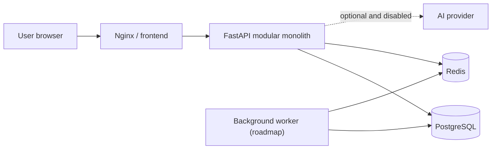

# System architecture

## Context

Avenward is a browser-based, self-hosted defensive monitoring platform. Version
`0.1.0` adds the first tenant-scoped event workflow to the modular monolith.

## Container view

Nginx serves the built React application and proxies `/api/` requests to the
backend. FastAPI owns validation, authorization, and business orchestration.
PostgreSQL is the durable system of record. Redis is reserved for short-lived
coordination, throttling, and job queues; it is not authoritative storage.

## Internal module boundaries

The backend will grow within one deployable application:

- identity: authentication, users, organizations, roles
- inventory: environments, assets, and data sources
- events: ingestion, parsing, normalization, storage, and search
- detections: declarative rules, anomaly scoring, and alert creation
- investigations: alerts, incidents, comments, and evidence
- operations: metric samples and health summaries
- explanations: template, local, and external AI provider interfaces
- delivery: reports and notification providers
- governance: audit logs and administration

API handlers translate HTTP requests and responses. Domain services enforce
business rules. Repositories apply organization scoping and persistence. Models
and schemas do not contain provider-specific network calls.

## Foundation request flow

1. Nginx receives a request.
2. Static paths return the React application.
3. `/api/` paths are proxied to FastAPI with a request identifier.
4. `/health` reports process liveness only.
5. `/ready` performs bounded PostgreSQL and Redis pings and returns `503` when a
   required dependency is unavailable.
6. Structured logs record status and duration without sensitive content.

## Data strategy

- PostgreSQL UUID primary keys and timezone-aware timestamps
- `organization_id` on tenant-owned rows and mandatory scoping in repositories
- database migrations for every schema change
- JSON only for source-specific or evolving attributes, not core relationships
- short raw-event retention by default, specified before ingestion ships
- no premature partitioning; add it only after measured query and ingest tests

Alembic owns schema history. Organizations, users, revocable sessions, and
canonical events are durable PostgreSQL records. Every event query includes the
authenticated user's `organization_id`; raw source fields are retained in JSONB
but are neither searched by default nor written to operational logs.

## AI boundary

AI is an explanation layer, not the detection authority. Providers implement a
common interface with disabled and deterministic template modes available before
any external provider. Retrieved records are untrusted evidence, never policy or
instructions. External transmission requires enablement, minimization, redaction,
and audit logging.

## Operational characteristics

- JSON application logs written to standard output
- request IDs accepted only as bounded, sanitized values or generated internally
- health and readiness separated for orchestration
- explicit configuration from environment variables
- non-root application containers
- dependency health checks and named development volumes

## Deployment stages

1. Local Docker Compose
2. Single hardened Linux VM
3. Cloud VM with optional managed PostgreSQL

Kubernetes, microservices, and automatic production deployment are intentionally
outside the MVP.

## Significant decisions

See [`docs/adr`](../adr/) for decision records. Material changes require a new
ADR rather than silently rewriting history.
