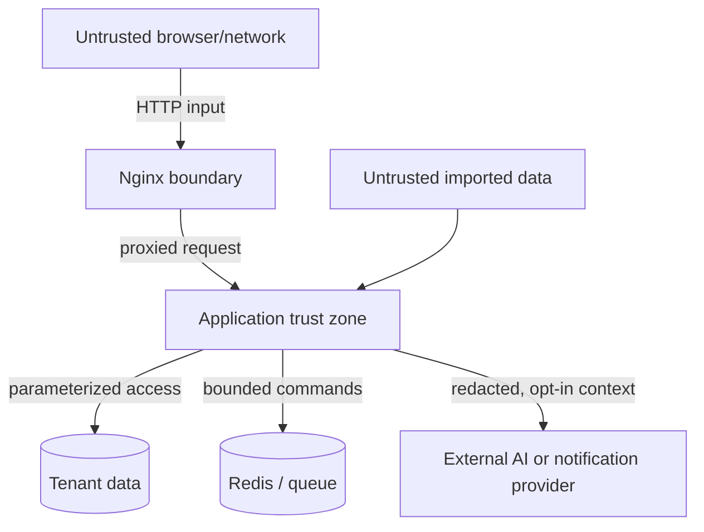

# Avenward threat model

## Status and method

This foundation threat model uses lightweight STRIDE analysis. It must be updated
when authentication, uploads, multi-tenancy, AI providers, or public deployment
are implemented.

## Assets to protect

- User identities, sessions, reset and authentication material
- Organization separation and authorization decisions
- Raw events, normalized events, alerts, incidents, and reports
- Data-source and notification configuration
- AI provider credentials and transmitted context
- Audit history, backups, model artifacts, and system availability

## Actors

- Authorized viewer, analyst, administrator, and platform administrator
- Malicious or compromised account
- Unauthenticated remote actor
- Contributor or dependency introducing vulnerable code
- Adversarial content embedded in logs, filenames, or comments
- Misconfigured external provider or notification destination

## Trust boundaries

Local Docker is a development convenience, not a security boundary suitable for
hostile public traffic.

## Primary threats and planned controls

| Threat | Consequence | Required control |
| --- | --- | --- |
| Broken tenant authorization / IDOR | Cross-organization disclosure | Central organization context, scoped repositories, endpoint and negative tests |
| Credential theft or session replay | Account takeover | Argon2id, short-lived access, revocable refresh/session design, secure cookies, throttling, audit |
| Malicious or oversized upload | Code execution or denial of service | Allowlisted formats, streaming limits, row limits, safe names, no execution, isolated parsing |
| SQL or query injection | Disclosure or mutation | Parameterized queries, typed filters, bounded operators, security tests |
| XSS in event content | Browser compromise | React escaping, strict rendering, CSP, safe exports, no raw HTML |
| SSRF through integrations | Internal service access | Scheme/host policy, deny private destinations by default, timeouts, redirect controls |
| Prompt injection in evidence | Misleading AI behavior | Separate policy/user/evidence channels, quote evidence, allowlisted tools, no autonomous action |
| Secret leakage in logs or AI | Credential compromise | Central redaction, minimal context, denylisted fields, tests, provider audit |
| Queue or ingestion flood | Resource exhaustion | Payload limits, quotas, backpressure, bounded workers, metrics, rate limiting |
| Dependency compromise | Build/runtime compromise | Lock files, review, Dependabot, dependency and container scanning, SBOM roadmap |
| Backup exposure | Historical data disclosure | Encryption, access separation, retention, restore testing, documented deletion |

## Foundation controls

- No authentication or sensitive data is accepted in `0.0.1`.
- Health endpoints return minimal operational metadata.
- Readiness requests use timeouts and do not return connection strings.
- Environment files and common credential formats are ignored by Git.
- Containers use unprivileged users where practical.
- CORS is configured explicitly rather than allowing arbitrary origins.
- Synthetic data is the only permitted development data.

## Security requirements before `0.1.0` completion

- Authentication ADR and implementation review
- Tenant-aware schema and cross-organization negative tests
- Login throttling, session revocation, and authentication audit events
- Upload size and content validation
- Security headers and CSRF decision
- Secret redaction unit tests

## Residual risk

This is pre-release software. It has not undergone penetration testing,
independent review, performance testing, or production hardening. It must remain
on a developer-controlled machine and must not receive real organizational data.
